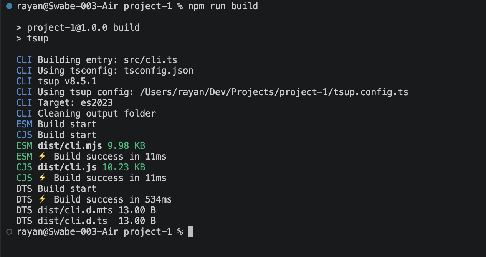
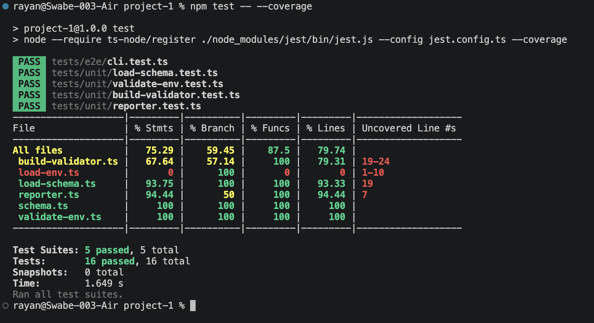
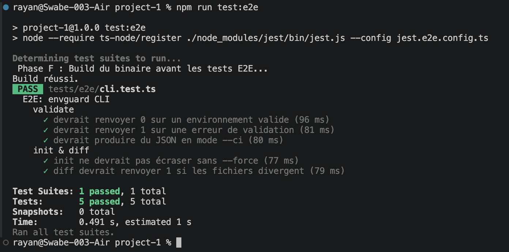
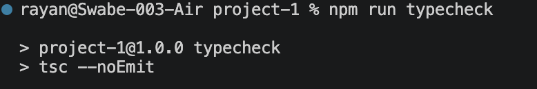
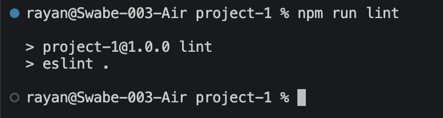
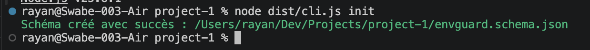
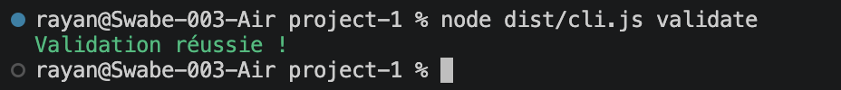
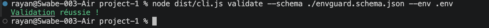
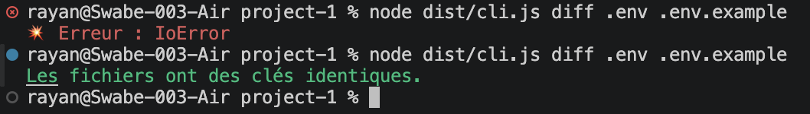
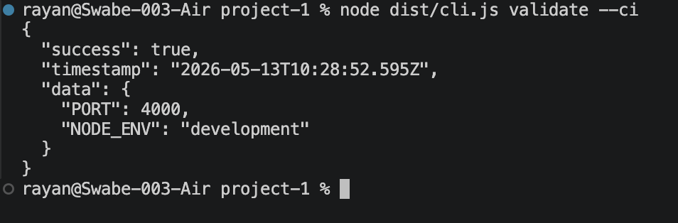

# envguard CLI

envguard est un outil de ligne de commande conçu pour valider les fichiers d'environnement par rapport à un schéma JSON déclaratif, garantissant la cohérence des configurations entre les environnements de développement et de production.

## Installation

```bash
npm install
npm run build

```

## Usage Examples

### 1. Initialize a schema

Generate a default `envguard.schema.json` in the current directory.

```bash
node dist/cli.js init

```

### 2. Validate environment

Check the `.env` file against the current schema.

```bash
node dist/cli.js validate

```

### 3. Compare environments

Identify missing keys between two environment files.

```bash
node dist/cli.js diff .env .env.example

```

## Test & verification de FR

Cette section regroupe les preuves de succès pour chaque exigence fonctionnelle et technique du projet.

### 1. Build du projet

Commande : `npm run build`

Result : 
<details>

  <summary>Cliquez pour voir les tests unitaires (Jest)</summary>

  

</details>

### 2. Resultats des Tests : Unitaires (Jest) & Coverage

Commande : `npm test -- --coverage`

Result : 
<details>

  <summary>Cliquez pour voir les tests unitaires (Jest)</summary>

  

</details>

### 3. Resultats des Tests : E2E

Commande : `npm run test:e2e`

Result : 
<details>

  <summary>Cliquez pour voir les tests unitaires (Jest)</summary>

  

</details>

### 4. Verification du typage

Commande : `npm run typecheck`

Result : 
<details>

  <summary>Cliquez pour voir les tests unitaires (Jest)</summary>

  

</details>

### 5. Analyse statique (Lint)

Commande : `npm run lint`

Result : 
<details>

  <summary>Cliquez pour voir les tests unitaires (Jest)</summary>

  

</details>

### 6. FR-3 : Initialisation du schema

Commande : `node dist/cli.js init`

Result : 
<details>

  <summary>Cliquez pour voir les tests unitaires (Jest)</summary>

  

</details>

### 7. FR-1 : Validation standard

Commande : `node dist/cli.js validate`

Result : 
<details>

  <summary>Cliquez pour voir les tests unitaires (Jest)</summary>

  

</details>

### 8. FR-4 : Validation avec arguments explicites

Commande : `node dist/cli.js validate --schema ./envguard.schema.json --env .env`

Result : 
<details>

  <summary>Cliquez pour voir les tests unitaires (Jest)</summary>

  

</details>

### 9. FR-2 : Comparaison d'environnements (Diff)

Commande : `node dist/cli.js diff .env .env.example`

Result : 
<details>

  <summary>Cliquez pour voir les tests unitaires (Jest)</summary>

  

</details>

### 10. FR-5 : Mode CI (Output JSON)

Commande : `node dist/cli.js validate --ci`

Result : 
<details>

  <summary>Cliquez pour voir les tests unitaires (Jest)</summary>

  

</details>

## Schema Reference

| Property | Type | Description |
| --- | --- | --- |
| `type` | string | Field type: `string`, `number`, `boolean`, `url`, `enum`. |
| `required` | boolean | If true, validation fails if the key is missing. |
| `default` | any | Value assigned if the key is missing from the environment. |
| `values` | string[] | Array of allowed strings (required for type `enum`). |
| `pattern` | string | Regex pattern for `string` validation. |

## Exit Codes

| Code | Meaning |
| --- | --- |
| 0 | Success |
| 1 | Validation Failure |
| 2 | Configuration Error (Schema) |
| 3 | IO / System Error |

## License

MIT License - Copyright (c) 2026 Rayan Junior Fogue
